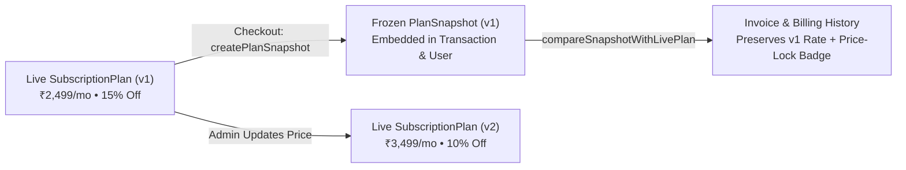

# APEX PULSE — Fitness Subscription & Billing Management System

> **Live Demo**: [https://apex-pulse-ivory.vercel.app](https://apex-pulse-ivory.vercel.app)

A full-stack **Fitness Subscription & Billing Management Platform** built with **Next.js 14 (App Router)**, **TypeScript (`strict: true`)**, **Tailwind CSS**, **Clerk Authentication (RBAC + Webhooks)**, and **MongoDB (Mongoose ODM)**. All monetary values and invoices are denominated in **Indian Rupees (`INR / ₹`)**.

---

## Table of Contents

1. [Key Features](#1-key-features)
2. [System Architecture & Folder Structure](#2-system-architecture--folder-structure)
3. [Quick Start & Local Setup](#3-quick-start--local-setup)
4. [Snapshot Strategy: Historical Billing Integrity](#4-snapshot-strategy-historical-billing-integrity)
5. [Automated Testing & Code Coverage](#5-automated-testing--code-coverage)

---

## 1. Key Features

| Module | Implementation Details |
| :--- | :--- |
| **Tech Stack** | Next.js 14 (App Router), TypeScript (`strict: true`), Tailwind CSS, Lucide Icons, MongoDB + Mongoose ODM, Clerk Auth (`@clerk/nextjs` + `svix`). |
| **Authentication & RBAC** | Unified `/sign-in` and `/sign-up` portals supporting **Member** and **Club Admin** accounts, `/auth/redirect` role dispatcher (`ADMIN` $\rightarrow$ `/admin/dashboard`, `USER` $\rightarrow$ `/dashboard`), and Clerk Webhook sync (`POST /api/webhooks/clerk`). |
| **Database Schema & Models** | `SubscriptionPlan`, `User` (with embedded `subscription`, `planSnapshot`, and scheduled `upcomingSubscription`), `Transaction` (with `PARTIAL` / `COMPLETED` / `PENDING`, `planSnapshot`, `pricingBreakdown`, `overrideAudit`), and `Coupon` (`FLAT` & `PERCENTAGE`). |
| **Member Subscription & Billing** | Multi-month commitment plans with automatic savings, Checkout Modal supporting **100% Full Payment** vs. **Split / Partial Installment Payment**, promo code application (`APEX20`), scheduled plan upgrades/downgrades after current cycle expiry, **Activation & 3-Day Expiry Warning Banners**, and `/billing` ledger with single-page **Printable Invoices**. |
| **Club Admin Console (`/admin/dashboard`)** | **Plan Manager** (Create, Edit, Delete plans with interactive facility checkboxes and automatic `version` increments on price changes), **Coupon Manager** (Create, Toggle, Delete `FLAT` and `PERCENTAGE` coupons), and **Global Transaction Oversight** with 1-click **`PARTIAL` $\rightarrow$ `COMPLETED` Status Override** and audit trail. |

---

## 2. System Architecture & Folder Structure

```text
├── src/
│   ├── app/                        # Next.js 14 App Router Pages & REST API Route Handlers
│   │   ├── about/page.tsx          # Club & Facilities Overview (/about)
│   │   ├── admin/dashboard/page.tsx# Club Admin Console (/admin/dashboard)
│   │   ├── auth/redirect/page.tsx  # Role-Based Post-Login Dispatcher (/auth/redirect)
│   │   ├── billing/page.tsx        # Member Billing & Invoice Ledger (/billing)
│   │   ├── dashboard/page.tsx      # Member Training & Subscription Portal (/dashboard)
│   │   ├── sign-in/[[...sign-in]]/ # Sign-In Portal (/sign-in)
│   │   ├── sign-up/[[...sign-up]]/ # Sign-Up Portal (/sign-up)
│   │   └── api/                    # REST Endpoints (plans, coupons, checkout, transactions, webhooks/clerk)
│   ├── components/                 # Modular UI & Domain Components
│   │   ├── admin/                  # AdminConsoleClient (Plan CRUD, Coupon CRUD, Ledger Override)
│   │   ├── auth/                   # BrandedAuthPortal (Member & Club Admin Auth)
│   │   ├── dashboard/              # SubscriptionAlerts, CheckoutModal, InvoiceModal, BillingHistoryClient
│   │   ├── layout/                 # Navbar, Footer
│   │   └── marketing/              # PricingGrid & Commitment View Toggle
│   ├── lib/                        # Pure Domain Engines, Validators & Infrastructure Singletons
│   │   ├── auth.ts                 # Session Resolver & Role Guard
│   │   ├── db.ts                   # Mongoose Singleton + Automatic MongoMemoryServer Fallback
│   │   ├── seed.ts                 # Idempotent INR Database Seeder (Plans & Coupons)
│   │   ├── snapshot-service.ts     # Immutable PlanSnapshot Builder & Live Catalog Drift Detector
│   │   ├── subscription-engine.ts  # Deterministic Pricing, Coupon, Installment Split & 3-Day Expiry Math
│   │   ├── utils.ts                # INR Currency Formatter (en-IN), Date Helpers & Invoice Generator
│   │   ├── validators.ts           # Strict Zod Schemas for API & Form Boundaries
│   │   └── webhook-processor.ts    # Svix Webhook Signature Verifier & Idempotent Clerk User Sync
│   ├── models/                     # Mongoose Schemas (SubscriptionPlan, User, Transaction, Coupon)
│   ├── services/                   # Data-Access & Domain Orchestration Layer
│   └── types/                      # Shared TypeScript Domain Interfaces & DTOs
└── tests/
    ├── unit/                       # Unit Tests (Pricing Engine, Validators, Snapshot, Webhooks)
    └── integration/                # Database & Service Workflow Integration Tests
```

---

## 3. Quick Start & Local Setup

### Step 1: Install Dependencies

```bash
npm install
```

### Step 2: Start the Development Server

```bash
npm run dev
```

Open [http://localhost:3000](http://localhost:3000) in your browser.
- **Local Development**: Automatically boots an embedded MongoDB instance pre-seeded with the 4 INR fitness plans and active `APEX20` promo coupon.
- **Production Deployment (Vercel)**: Add `MONGODB_URI` (MongoDB Atlas connection string) in your Vercel project Environment Variables.

---

## 4. Snapshot Strategy: Historical Billing Integrity

### Problem Statement: Why Foreign-Key Lookups Alone Fail in Subscription Billing
In a naive database design, a `Transaction` document only stores a foreign-key reference (`planId: ObjectId`) to the `SubscriptionPlan` collection and populates the plan dynamically when rendering `/billing` or `/admin/dashboard`.

That approach breaks historical financial integrity as soon as an Admin updates or deletes a plan:
1. **Retroactive Invoice Mutation**: If a member purchased the *Quarterly Transformation* plan at `₹2,499/mo` (`15%` discount) in October, and an Admin increases the plan price to `₹3,499/mo` (`10%` discount) in November, joining the live `SubscriptionPlan` makes the October invoice display `₹3,499/mo`, contradicting the `totalAmount` actually charged.
2. **Broken Partial-Payment Math**: For members on split-payment (`PARTIAL`) plans, recalculating against a mutated live plan breaks the invariant `amountPaid + remainingBalance === totalAmount`.
3. **Orphaned References on Plan Deletion**: If an Admin deletes a legacy plan, historical transactions lose their plan name, duration, and billing metadata.

### Solution: Immutable Embedded `PlanSnapshot` + Monotonic Plan Versioning



1. **Point-in-Time Freezing (`createPlanSnapshot` in `src/lib/snapshot-service.ts`)**:
   At the exact moment of checkout (`processCheckout` in `src/services/subscription.service.ts`), the system captures an immutable `PlanSnapshot` (`planId`, `name`, `durationMonths`, `baseMonthlyPrice`, `discountPercentage`, `version`, `capturedAt`) along with the itemized `pricingBreakdown` and embeds them directly inside both the `Transaction` document and `User.subscription` (or `User.subscription.upcomingSubscription` when queuing an upgrade/downgrade).
2. **Monotonic Plan Versioning (`updatePlan` in `src/services/plan.service.ts`)**:
   Whenever an Admin modifies a plan's commercial terms (`baseMonthlyPrice`, `discountPercentage`, or `durationMonths`), `hasPlanPricingChanged()` automatically increments `SubscriptionPlan.version` (`v1` $\rightarrow$ `v2`).
3. **Live Drift Detection (`compareSnapshotWithLivePlan`)**:
   In `/billing` and the Printable Invoice Modal, each historical invoice compares its frozen `planSnapshot` against the current catalog plan. If an Admin has changed the plan's price or deleted the plan, a **Price-Lock Protection Badge** confirms that the member's historical invoice and remaining balance remain locked at their original rate.

---

## 5. Automated Testing & Code Coverage

```bash
# Run TypeScript check, ESLint, and Vitest coverage suite
npm run quality

# Run unit & integration tests with coverage report
npm run test:coverage

# Build for production
npm run build
```
